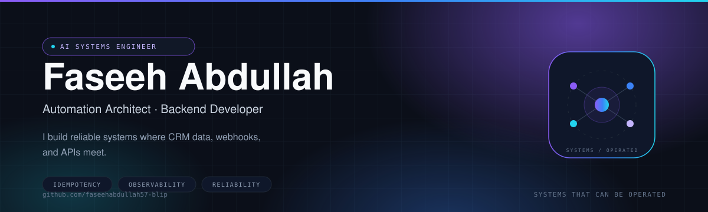
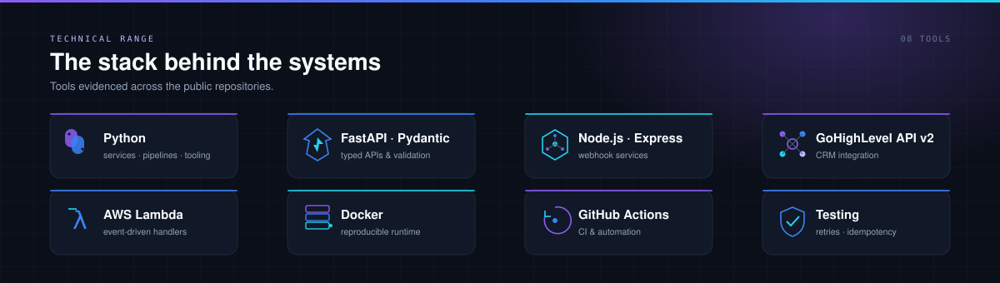
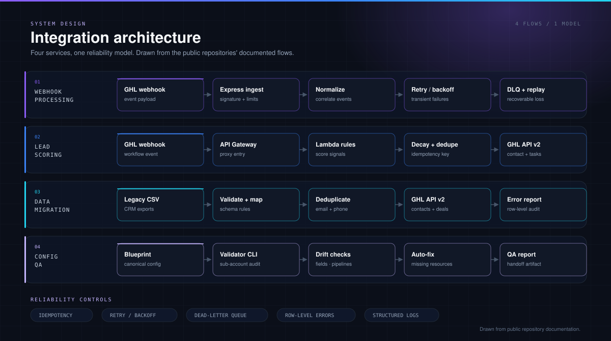
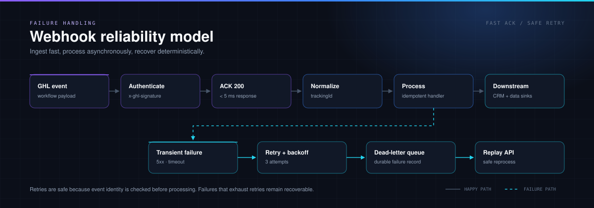

  

  <a href="#selected-engineering-work">Work</a> ·
  <a href="#architecture">Architecture</a> ·
  <a href="#repository-signals">Signals</a> ·
  <a href="#contact">Contact</a>

I build backend systems that make business operations legible: event-driven integrations,
reliable data pipelines, and AI-assisted workflows. My work sits where CRM data,
webhooks, and APIs meet.

Currently building a GoHighLevel integration suite — webhook ingestion, lead scoring,
data migration, and configuration QA.

---

## Operating principles

I optimize for systems that can be operated, not just demonstrated.

- **Explicit contracts.** Validate at the boundary. Make failure modes visible.
- **Idempotency by default.** Webhooks retry, imports rerun, people double-click.
- **Observability over silence.** Correlation IDs and structured logs are part of the interface.
- **Boring reliability.** Backoff, dead-letter queues, and row-level error reports beat clever failure handling.

---

## Engineering focus

| Area | What I work on |
| :--- | :--- |
| **AI systems** | Applied LLM integration, tool calling, and AI-assisted qualification workflows |
| **Automation** | Webhook pipelines, event-driven processing, retries, dead-letter queues |
| **Backend** | Python/FastAPI and Node/Express services with typed boundaries and tests |
| **CRM infrastructure** | GoHighLevel API v2, configuration drift detection, migration and validation |

---

## Technical range

**Languages** Python · JavaScript · TypeScript

**Backend & APIs** FastAPI · Pydantic · Node.js · Express · REST APIs

**Integration & data** Webhooks · CSV/ETL pipelines · GoHighLevel API v2

**Runtime & delivery** AWS Lambda · Serverless Framework · Docker · GitHub Actions

**Engineering practice** Unit tests · retry/backoff · idempotency · structured logging · configuration-as-code

---

## Selected engineering work

<!-- featured-projects:start -->

[ghl-snapshot-validator](https://github.com/faseehabdullah57-blip/ghl-snapshot-validator) · [ghl-webhook-processor.](https://github.com/faseehabdullah57-blip/ghl-webhook-processor.) · [ghl-data-migration-tool](https://github.com/faseehabdullah57-blip/ghl-data-migration-tool) · [ghl-lead-scoring-service](https://github.com/faseehabdullah57-blip/ghl-lead-scoring-service)

_Ranking: recency, stars/forks, description, tests, CI, Docker, releases, documentation, and repository size. Ties break by stars, then most recent push._

Project details

- **[ghl-snapshot-validator](https://github.com/faseehabdullah57-blip/ghl-snapshot-validator)** — A CLI that audits GoHighLevel sub-account configuration against a canonical blueprint, detects drift across fields, pipelines, and workflows, and can auto-fix missing resources.
- **[ghl-webhook-processor.](https://github.com/faseehabdullah57-blip/ghl-webhook-processor.)** — An Express service that authenticates and normalizes GoHighLevel webhooks, acknowledges fast, then forwards events with retries, a dead-letter queue, and replay support.
- **[ghl-data-migration-tool](https://github.com/faseehabdullah57-blip/ghl-data-migration-tool)** — A config-driven migration pipeline that maps legacy CSV exports, validates contacts, opportunities, and notes, and loads them into GoHighLevel API v2 with row-level error reports.
- **[ghl-lead-scoring-service](https://github.com/faseehabdullah57-blip/ghl-lead-scoring-service)** — A serverless, event-driven lead scoring engine with configurable rules, inactivity decay, webhook idempotency, and speed-to-lead task creation.

<!-- featured-projects:end -->

Repository index

<!-- project-index:start -->

| Repository | Focus | Stack | Updated |
| :--- | :--- | :--- | :--- |
| [leadflow-crm](https://github.com/faseehabdullah57-blip/leadflow-crm) | A FastAPI foundation for an AI-assisted CRM: API scaffolding for lead capture, qualification, and follow-up workflows. Early-stage. | Python | 2026-11-10 |
| [pddg-cybersecurity](https://github.com/faseehabdullah57-blip/pddg-cybersecurity) | A TypeScript content and site build for Pinnacle Digital Defense Group, a cybersecurity services brand. | TypeScript | 2026-07-16 |
| [Ai-checker](https://github.com/faseehabdullah57-blip/Ai-checker) | A static HTML/CSS/JavaScript portfolio site for Faseeh Digital's SEO, social media, and advertising services. | HTML | 2026-03-31 |
| [fadigital.github.io](https://github.com/faseehabdullah57-blip/fadigital.github.io) | A single-page GitHub Pages site for Faseeh Digital's services. | HTML | 2025-08-21 |

<!-- project-index:end -->

---

## Architecture

The public repositories document four integration paths and one shared reliability model.

- **Webhook processing** — authenticate, normalize, retry, dead-letter, replay
- **Lead scoring** — API Gateway → Lambda rules → score/decay → GHL API
- **Data migration** — CSV → validate/map → dedupe → GHL API → row-level errors
- **Configuration QA** — blueprint → validator → drift checks → auto-fix → QA report

Each path is designed around the same failure boundaries: authenticated ingress, idempotent
processing, bounded retries, and an auditable recovery path.

---

## Current focus

- hardening webhook ingestion with idempotency, retry/backoff, and replay
- detecting sub-account configuration drift before client onboarding
- validating and migrating CRM records without silent data loss
- exploring AI-assisted lead qualification in [LeadFlow CRM](https://github.com/faseehabdullah57-blip/leadflow-crm) (early-stage)

The common thread is failure handling: what happens when a webhook arrives twice, a CSV
row is malformed, or a client's configuration silently changes.

---

## Recent activity

<!-- recent-activity:start -->

- **2026-11-13** · [ghl-snapshot-validator](https://github.com/faseehabdullah57-blip/ghl-snapshot-validator) · Complete GoHighLevel snapshot configuration validator CLI with multi-location batch audit and auto-fix ([`0d3437f`](https://github.com/faseehabdullah57-blip/ghl-snapshot-validator/commit/0d3437fea73a6f74e566fe5d709c49df64d97e8d))
- **2026-11-13** · [ghl-lead-scoring-service](https://github.com/faseehabdullah57-blip/ghl-lead-scoring-service) · feat: add inactivity time-decay, webhook idempotency, and speed-to-lead task creation ([`4263aaa`](https://github.com/faseehabdullah57-blip/ghl-lead-scoring-service/commit/4263aaabe4786719f9240ca9ba1e6b114c7349d4))
- **2026-11-13** · [ghl-lead-scoring-service](https://github.com/faseehabdullah57-blip/ghl-lead-scoring-service) · Complete GoHighLevel serverless lead scoring microservice ([`3b41206`](https://github.com/faseehabdullah57-blip/ghl-lead-scoring-service/commit/3b412060d8289a8f310531d8a09df4ea0ce3d299))
- **2026-11-13** · [ghl-webhook-processor.](https://github.com/faseehabdullah57-blip/ghl-webhook-processor.) · Complete GoHighLevel webhook processor with DLQ, replay API, and Docker ([`afe4be2`](https://github.com/faseehabdullah57-blip/ghl-webhook-processor./commit/afe4be20a610dfdd17c2de4fb31192529dff79c0))
- **2026-11-13** · [ghl-data-migration-tool](https://github.com/faseehabdullah57-blip/ghl-data-migration-tool) · feat: add Opportunities & Notes migration, PII gitignore rules, and Docker support ([`af12149`](https://github.com/faseehabdullah57-blip/ghl-data-migration-tool/commit/af121497509199007f31b32be56a688d4ccb38f6))
- **2026-11-13** · [ghl-webhook-processor.](https://github.com/faseehabdullah57-blip/ghl-webhook-processor.) · feat: add Dead-Letter Queue, admin replay API, failure alerts, bi-directional GHL sync, and Docker ([`363bcb3`](https://github.com/faseehabdullah57-blip/ghl-webhook-processor./commit/363bcb320d0b15b790e3b97753bcdbdb64384a9b))

<!-- recent-activity:end -->

---

## Latest releases

<!-- latest-releases:start -->

_No published releases across public repositories yet. Tagged releases will appear here automatically._

<!-- latest-releases:end -->

---

## Repository signals

<!-- repository-signals:start -->

Raw signal values

| Signal | Value |
| :--- | :--- |
| Public repositories | **8** |
| Primary languages | Python ×4 · HTML ×2 · JavaScript ×1 · TypeScript ×1 |
| Top 3 languages by bytes | Python 66% · JavaScript 16% · TypeScript 11% |
| Test suites detected | **4** of 8 |
| CI workflows detected | **1** of 8 |
| Repositories with releases | **0** |
| Latest public commit | **2026-11-13** |

_Excludes this profile repository. Signals are derived from default branches._

<!-- repository-signals:end -->

---

## Commit activity

<!-- commit-activity:start -->

_Public commits on default branches, 2026-09-06 through 2026-11-23 (8 commits; source: repository statistics)._

<!-- commit-activity:end -->

---

## Contact

GitHub: [@faseehabdullah57-blip](https://github.com/faseehabdullah57-blip)

Open to engineering collaborations on AI systems, CRM automation, and backend infrastructure.
The most reliable way to reach me is through a GitHub issue or discussion on the relevant repository.

---

*Build systems that solve real problems. Make them reliable. Keep them maintainable.*
